# Factory model - generated diagram

*Generated from `factory-model.json` schema v5, model
v11 (2026-07-21), canonical identity
`sha256:66e574fe70bea46041f3e3646251d16e43ef3154eeb90bf69a5383216e324a59`. Do not edit by hand - edit the model, update its identity,
and re-run the projector. Hexagons = human; dashed rounded nodes = AI agent;
rectangles = deterministic software. Dotted edges are decision or feedback
paths; inspect their labels and endpoints to distinguish human gates from the
learning loop.*

Phase 1 keeps supervisor, postgresql, artifact store, dashboard, publisher on the
`control-plane-vm` and runs implement and verify on a
`dedicated-droplet` with no standing secrets, database access, fleet
credentials, or execution access to the private network. The only runtime
credential is `short-lived-spend-capped-model-only`. Bootstrap is performed by
`orchestration-vm-agents` applying `opentofu` and
`ansible` desired state from the
`factory` repository; at runtime the control
plane manages itself (`self`,
no runtime dependency on orchestration host).

```mermaid
%% factory-model schema v5, model v11
%% canonical sha256:66e574fe70bea46041f3e3646251d16e43ef3154eeb90bf69a5383216e324a59
flowchart LR
  intake["Intake<br/><i>deterministic</i>"]:::det
  triage(["Triage<br/><i>agent</i>"]):::agent
  implement(["Implement<br/><i>agent</i>"]):::agent
  verify["Verify<br/><i>deterministic</i>"]:::det
  approve{{"Approve<br/><i>human</i>"}}:::human
  deploy["Deploy<br/><i>deterministic</i>"]:::det
  close["Close the loop<br/><i>deterministic</i>"]:::det
  plan{{"Plan bin<br/><i>human</i>"}}:::human
  ledger["Ledger<br/><i>deterministic</i>"]:::det
  rubric{{"Rubric<br/><i>human</i>"}}:::human
  proposer(["Improvement proposer<br/><i>agent</i>"]):::agent
  intake --> triage
  triage -->|"lane A"| implement
  triage -->|"lanes B, C, D"| plan
  plan -.->|"approved"| implement
  plan -.->|"answered"| triage
  plan -.->|"binned"| ledger
  implement --> verify
  verify --> approve
  approve -.->|"approved"| deploy
  approve -.->|"changes requested"| implement
  approve -.->|"rejected"| ledger
  deploy --> close
  close --> ledger
  ledger -.->|"learning loop"| rubric
  ledger -.->|"evidence read (n>=10 rates)"| proposer
  proposer -.->|"policy PR - human merge only"| rubric
  rubric -.->|"policy edit via PR"| triage
  classDef human fill:#eaf2fc,stroke:#2a78d6,stroke-width:2.5px,color:#1c5cab
  classDef agent fill:#fdf6ec,stroke:#b07d2b,stroke-dasharray:5 3,color:#7c5200
  classDef det fill:#f4f5f7,stroke:#9aa0a8,color:#4c545f
```

